# Manual: SS12000-plugin för Koha

Version 2.0. Manualen är till för dig som är biblioteksadministratör och ställer in och följer upp importen. Systemadministratören som installerar pluginet använder [Installation_sv.md](Installation_sv.md). Vad pluginet gör och inte gör står i [Funktionslista.md](Funktionslista.md). Funktionerna i manualen hänvisas till med sitt ID, till exempel (F-13).

Texter i citattecken eller i **fetstil** är rubriker och knappar så som de står på sidan i Koha på svenska. Alla namn, skolor och personnummer i manualen och bilderna är påhittade.

## Innehåll

1. [Vad pluginet gör och inte gör](#1-vad-pluginet-gör-och-inte-gör)
2. [Snabbstart](#2-snabbstart)
3. [Konfigurationssidan, sektion för sektion](#3-konfigurationssidan-sektion-för-sektion)
4. [Så fungerar en körning](#4-så-fungerar-en-körning)
5. [Exempel från början till slut](#5-exempel-från-början-till-slut)
6. [Vanliga frågor och felsökning](#6-vanliga-frågor-och-felsökning)
7. [Dataskydd](#7-dataskydd)
8. [Ordlista](#8-ordlista)

## 1. Vad pluginet gör och inte gör

Pluginet läser elever (och personal, om ni beställt det) från skolans elevregister via IST och standarden SS12000. Det skapar och uppdaterar låntagare i Koha: namn, personnummer, klass, bibliotek, kontaktuppgifter och utgångsdatum.

Pluginet gör **inte** följande (se "Ingår inte" i funktionslistan): läser vårdnadshavare, foto eller undervisningsgrupper, sätter lösenord eller PIN-kod, eller sätter meddelandeinställningar för nya låntagare. Lånebestämmelser och de kategorier som nya elever får måste biblioteket skapa i Koha själv.

Det du ser i Koha finns på två ställen:

- **Konfigurationssidan.** Administration > Plugins > "Export av användare från SS12000" > Åtgärder > Konfigurera.
- **Loggsidan.** Administration > Plugins > "Importerade SS12000-användare (logg)". Den nås också från länken **SS12000-logg** högst upp på konfigurationssidan.

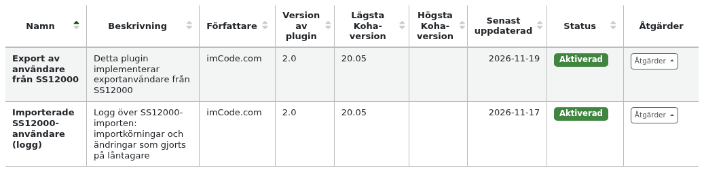

*Bild 1. Pluginlistan i Administration, med de två raderna för pluginet. Visar version 2.0.*

## 2. Snabbstart

Så här kommer du från installerat plugin till första importen. Varje steg förklaras längre fram.

1. Öppna konfigurationssidan. Saknas skolmappning eller standardkategori visas en varning.
2. Fyll i **Anslutning till IST**: Client ID, Client Secret och Customer ID. Kontrollera API URL och URL för åtkomsttoken. Tryck **Spara**.
3. Tryck **Testa anslutningen (använder sparade inställningar)**. Du ska få svaret att anslutningen fungerar och hur många organisationer IST har.
4. Välj **Standard låntagarkategori** under **Importregler**.
5. Under **Mappning av biblioteksenhet**: tryck **Hämta organisationer från IST** och välj bibliotek för varje skola (eller tryck **Föreslå mappning utifrån namn**). Tryck **Spara**.
6. Bestäm under **Låntagarens identitet** hur befintliga låntagare ska hittas. Har ni redan låntagare i Koha, läs avsnitt 3.2 först.
7. Kontrollera att texten "Konfigurationen har uppdaterats framgångsrikt" visas och att varningen är borta.
8. Under **Schema och kör nu**: tryck **Kör import nu**, eller lägg in tider i schemat. Båda kräver att systemadministratören lagt in minutjobbet i cron (se Installation_sv.md).
9. Följ körningen på loggsidan. En skola är klar för dagen när dess sista sida har status "done".

## 3. Konfigurationssidan, sektion för sektion

Sidan heter **Konfigurationsinställningar** och visar versionen. Överst finns en ruta om pluginet och en rad med genvägar till sektionerna i den ordning de visas: Anslutning till IST, Låntagarens identitet, Importregler, Mappning av biblioteksenhet, Mappning av låntagarkategorier, Kategoriregler, Schema och kör nu, Personal, Låntagare som slutat, Avancerat och länken SS12000-logg. Längst ned finns knappen **Spara** och knappen **Ställ in API-scanner från första sidan**.

*Bild 2. Konfigurationssidans början med genvägarna. Visar version 2.0.*

Sidan följer Kohas språk. Samma början på svenska och engelska:

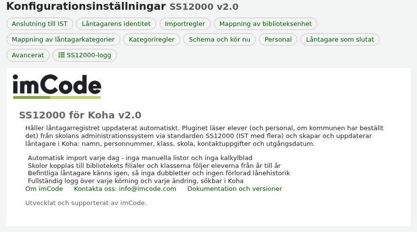

*Bild 3. Konfigurationssidans början på svenska. Visar version 2.0.*

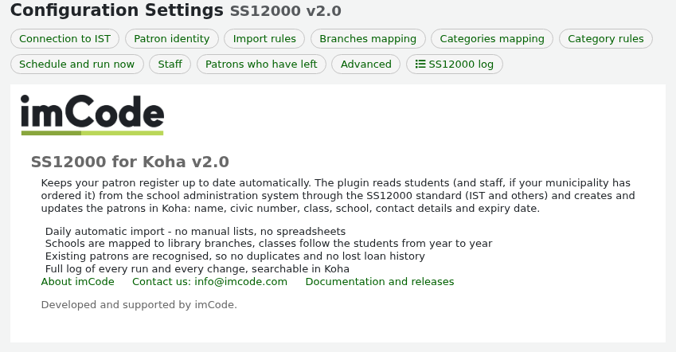

*Bild 4. Samma sida på engelska. Visar version 2.0.*

Alla inställningar sparas när du trycker **Spara**. Knapparna som hämtar från IST, **Kör import nu** och **Hämta värden från IST nu** gör sitt jobb direkt och använder de *sparade* IST-uppgifterna, så spara nycklarna först.

Visas "VARNING: Grenmappning och/eller kategorimappning är inte korrekt konfigurerad" saknas skolmappning, eller en standardkategori som finns i Koha. Importen kan inte köras förrän det är rättat.

### 3.1 Anslutning till IST

**Syfte.** Berätta för pluginet hur det loggar in hos IST. (F-01, F-02)

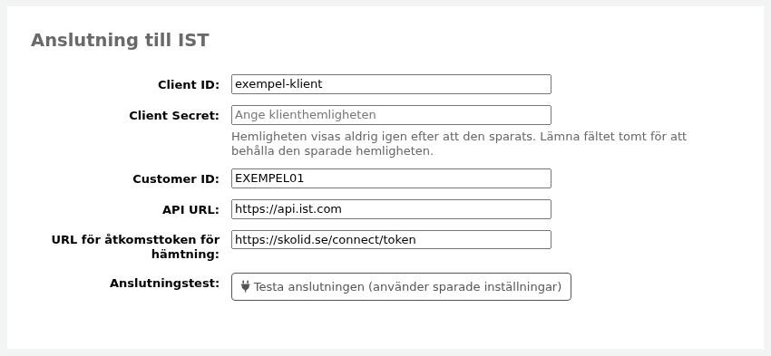

*Bild 5. Sektionen Anslutning till IST. Visar version 2.0.*

| Fält | Vad du skriver | Exempel |
|---|---|---|
| Client ID | Klient-id du fått från IST | `exempel-klient` |
| Client Secret | Klienthemligheten. Visas aldrig igen efter att du sparat. Lämna fältet tomt för att behålla den sparade. | |
| Customer ID | Ert kund-id hos IST | `EXEMPEL01` |
| API URL | Adressen till IST:s API. Standard: `https://api.ist.com` | |
| URL för åtkomsttoken för hämtning | Adressen där pluginet hämtar sin åtkomst. Standard: `https://skolid.se/connect/token` | |

Tryck **Testa anslutningen (använder sparade inställningar)**. Svaret säger hur många organisationer IST har, och om uppdrag (personal) inte ingår i er beställning.

**Vanliga misstag.**
- Du testar innan du sparat. Knappen använder det som är sparat.
- Du skriver hemligheten igen vid varje sparande. Det behövs inte, lämna fältet tomt.
- Fel Customer ID: åtkomst fås, men organisationerna ger ett HTTP-fel.

### 3.2 Låntagarens identitet

**Syfte.** Bestämma hur pluginet känner igen låntagare som redan finns i Koha, och vilka värden nya låntagare får som användar-ID och kortnummer. (F-20 till F-23)

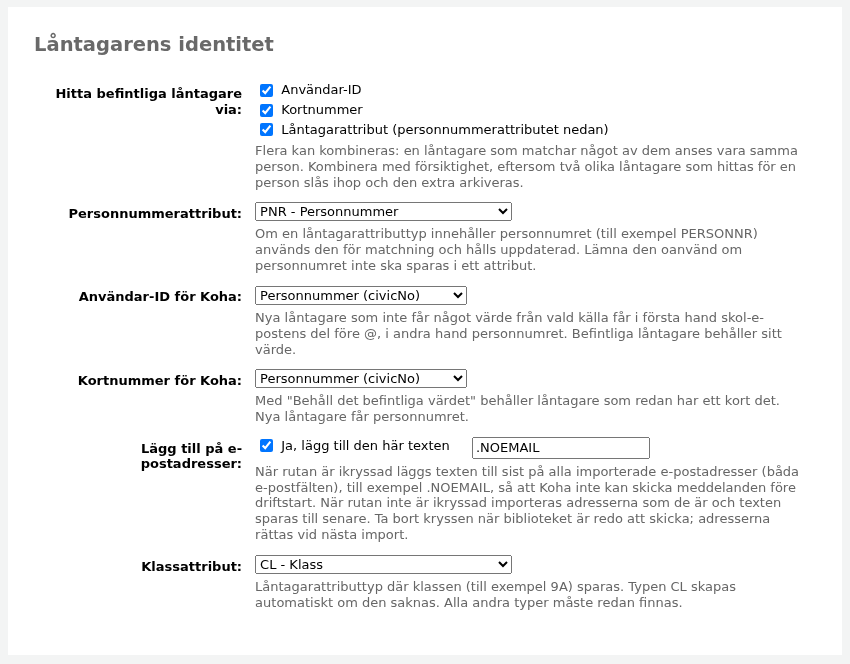

*Bild 6. Sektionen Låntagarens identitet. Visar version 2.0.*

| Fält | Vad det gör |
|---|---|
| Hitta befintliga låntagare via | Kryssa i ett eller flera sätt: **Användar-ID**, **Kortnummer**, **Låntagarattribut (personnummerattributet nedan)**. En låntagare som matchar något av dem anses vara samma person. Standard: användar-ID och kortnummer. |
| Personnummerattribut | Attributtyp i Koha som innehåller personnumret. Används för matchning och hålls uppdaterad. Bara siffror jämförs, så `20120811-4011` och `201208114011` är samma. |
| Användar-ID för Koha | Källa: **Personnummer (civicNo)**, **Externt id (externalIdentifier)**, **Skol-e-post, delen före @**, **Skol-e-post, hela adressen** eller **Behåll det befintliga värdet**. |
| Kortnummer för Koha | Källa: personnummer, externt id eller behåll det befintliga värdet. |
| Lägg till på e-postadresser | Kryssrutan "Ja, lägg till den här texten" och en text, till exempel `.NOEMAIL`. Texten läggs sist på alla importerade e-postadresser så att Koha inte kan skicka meddelanden före driftstart. Texten sparas även när rutan är urkryssad. |
| Klassattribut | Attributtyp där klassen (till exempel `9A`) sparas. Standard `CL`, skapas automatiskt om den saknas. En annan typ måste redan finnas. |

**Viktigt om befintliga låntagare.** Har ni redan låntagare i Koha måste matchningen peka på något som är lika i Koha och IST. Annars skapas en ny låntagare för varje elev. Titta på några låntagare i Koha: vad är användar-ID och kortnummer, och finns personnumret i ett attribut? Välj matchning efter det.

- Ligger personnumret i ett attribut: kryssa i **Låntagarattribut** och välj attributet som **Personnummerattribut**.
- Ska befintliga låntagare behålla sina värden: välj **Behåll det befintliga värdet** för **Användar-ID för Koha** och **Kortnummer för Koha**. Nya låntagare får då skolans e-postnamn som användar-ID, och personnumret som kortnummer.
- Ändrar du källa för användar-ID eller kortnummer startar dagens import om från första sidan. Sidan frågar först.

**Vanliga misstag.**
- Matchning via attribut utan att välja ett personnummerattribut. Sidan sparar inte identitetsinställningarna och säger det.
- Ingen matchning vald. Minst ett sätt måste väljas.
- Kryssar i **Lägg till på e-postadresser** utan text. Sidan sparar inte.
- Glömmer att kryssa ur den när biblioteket vill börja skicka meddelanden. Adresserna rättas vid nästa import.

### 3.3 Importregler

**Syfte.** Allmänna val för vilka personer som importeras och hur de behandlas. (F-04, F-07 till F-09, F-11, F-18, F-24, F-25)

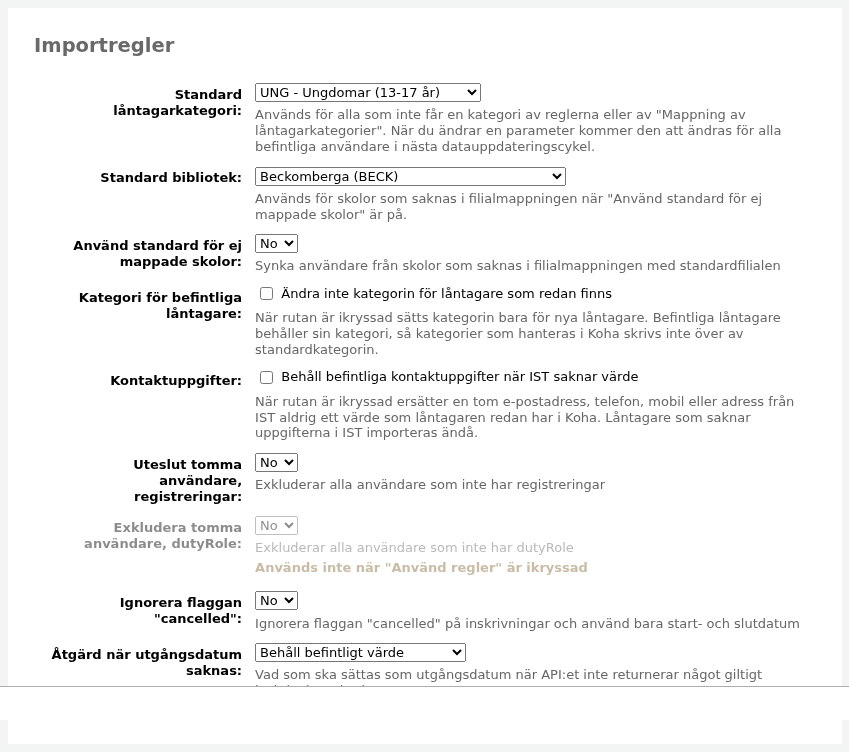

*Bild 7. Sektionen Importregler. Visar version 2.0.*

| Fält | Vad det gör |
|---|---|
| Standard låntagarkategori | Kategorin för alla som inte får en annan kategori av reglerna eller rollmappningen. Måste vara en kategori som finns i Koha. Obligatorisk. |
| Standard bibliotek | Biblioteket för skolor som saknas i skolmappningen, när "Använd standard för ej mappade skolor" är på. Annars "- ingen (hoppa över skolor utan mappning) -". |
| Använd standard för ej mappade skolor | **Ja**: en extra omgång utan skolfilter lägger elever från skolor som saknas i mappningen på standardbiblioteket. **Nej** (standard): de hoppas över. |
| Kategori för befintliga låntagare | Kryssrutan "Ändra inte kategorin för låntagare som redan finns". Kategorin sätts då bara för nya låntagare. Av som standard. |
| Kontaktuppgifter | Kryssrutan "Behåll befintliga kontaktuppgifter när IST saknar värde". En tom e-post, telefon, mobil eller adress från IST ersätter då aldrig ett värde som redan finns i Koha. Av som standard. |
| Uteslut tomma användare, registreringar | **Ja**: personer utan giltig inskrivning importeras inte. **Nej** (standard): de importeras ändå. |
| Exkludera tomma användare, dutyRole | **Ja**: personer utan roll importeras inte. **Elever har normalt ingen roll och utesluts då också**, så välj Ja bara om ni vill importera enbart personer med roll. Standard: Nej. Används inte när "Använd regler" är ikryssad. |
| Ignorera flaggan "cancelled" | **Ja**: IST:s markering att en inskrivning är avbruten ignoreras, bara start- och slutdatum gäller. **Nej** (standard): avbrutna inskrivningar räknas inte som giltiga. |
| Åtgärd när utgångsdatum saknas | Vad som sätts när IST inte ger något slutdatum för inskrivningen: **Inget (lämna tomt)**, **Behåll befintligt värde** (standard) eller **Sätt antal månader från idag** (1 till 120). Finns ett slutdatum används det alltid. |

När du ändrar en inställning gäller den för alla befintliga låntagare vid nästa uppdatering.

**Vanliga misstag.**
- Ingen standardkategori vald, eller en kategori som inte finns i Koha. Då visas varningen och importen körs inte.
- "Inget (lämna tomt)" för utgångsdatum tömmer utgångsdatumet på låntagare vars inskrivning saknar slutdatum. Välj "Behåll befintligt värde" om du inte vill det.
- Importen skapar låntagare i standardkategorin. Kategorin måste ha lånebestämmelser i Koha, annars kan eleverna inte låna.

### 3.4 Mappning av biblioteksenhet (skolmappning)

**Syfte.** Koppla varje skola (organisation) i IST till ett bibliotek (filial) i Koha. (F-16, F-17, F-19)

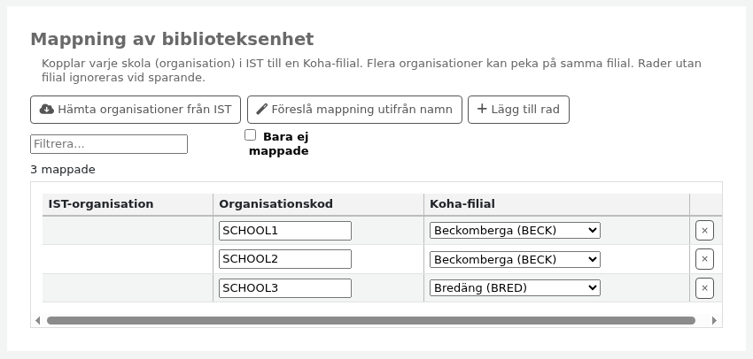

*Bild 8. Skolmappningen med tre exempelskolor. Visar version 2.0.*

Knappar och fält: **Hämta organisationer från IST**, **Föreslå mappning utifrån namn**, **Lägg till rad**, ett filterfält och kryssrutan **Bara ej mappade**. Tabellen har kolumnerna IST-organisation, Organisationskod och Koha-filial.

1. Tryck **Hämta organisationer från IST**. Sidan visar hur många organisationer som hämtats och hur många som är mappade.
2. Välj Koha-filial på varje rad. Flera skolor kan peka på samma filial.
3. Eller tryck **Föreslå mappning utifrån namn**. Förslagen markeras "Föreslagen". Rader som behöver kontrolleras markeras "Kontrollera denna". Granska och tryck **Spara**.
4. Rader utan filial ignoreras vid sparande.

En rad vars organisationskod finns i mappningen men inte i IST markeras "Finns inte i IST". Pluginet markerar den skolan som klar för dagen och går vidare (se avsnitt 4). Tryck **Ta bort** på raden om skolan inte ska vara med.

**Vanliga misstag.**
- Du glömmer att trycka **Spara**. Inget sparas förrän du trycker.
- Du kopplar till en filial som inte finns i Koha. Raden sparas inte och sidan säger det.
- Skolor utan koppling importeras inte (om inte "Använd standard för ej mappade skolor" är på).

### 3.5 Mappning av låntagarkategorier (roller, äldre läge)

**Syfte.** Koppla en roll (dutyRole, till exempel Lärare) i IST till en låntagarkategori i Koha. Bara roller i tabellen får den kategorin, alla andra får standardkategorin. (F-12)

Sektionen är valfri. Behöver ni bara elever kan den vara tom. Den används inte när "Använd regler" är ikryssad och är då utgråad.

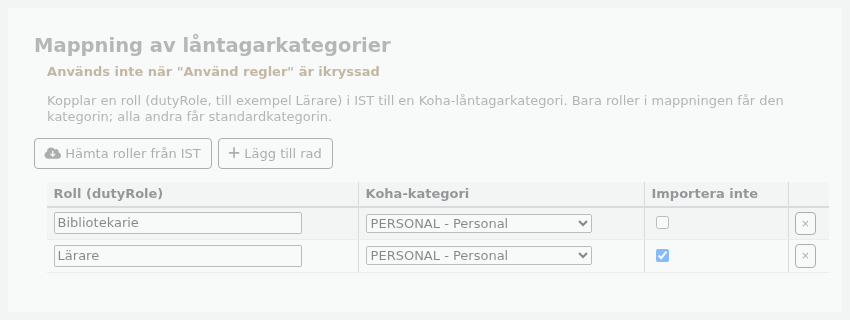

*Bild 9. Kategorimappningen med två exempelroller. Visar version 2.0.*

Knappar: **Hämta roller från IST** (kräver att uppdrag ingår i IST-beställningen) och **Lägg till rad**. Kolumner: Roll (dutyRole), Koha-kategori, Importera inte. Kryssar du i **Importera inte** importeras personer med den rollen inte alls.

**Vanliga misstag.**
- En roll som inte ska importeras måste ha **Importera inte** ikryssat, annars importeras den med standardkategorin.
- En kategori som tagits bort i Koha visas som "saknas i Koha". Rader med "Importera inte" behålls ändå.
- Bara personens första uppdrag används. Har en person flera roller kan reglerna (3.6) hantera det bättre.

### 3.6 Kategoriregler

**Syfte.** Avgöra låntagarens kategori med regler i stället för rollmappningen. En regel har villkor och en åtgärd. (F-13, F-14, F-15)

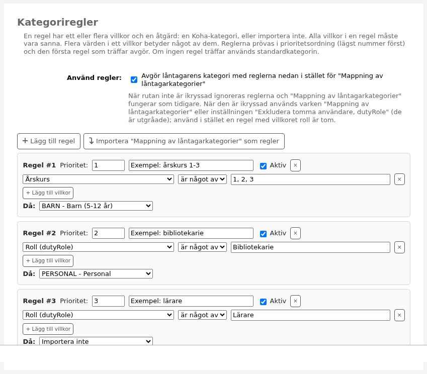

*Bild 10. Kategoriregler med två exempelregler. Visar version 2.0.*

Kryssrutan **Använd regler** styr allt. Ikryssad: reglerna avgör kategorin, och rollmappningen (3.5) och "Exkludera tomma användare, dutyRole" används inte (de är utgråade). Ej ikryssad (standard): reglerna ignoreras och allt fungerar som i rollmappningen. "Uteslut tomma användare, registreringar" gäller före reglerna i båda lägena.

**Så prövas reglerna.**
- En regel har ett eller flera **villkor** och en **åtgärd**: en Koha-kategori eller **Importera inte**.
- Alla villkor i en regel måste vara sanna. Flera värden i ett villkor betyder att något av dem räcker.
- Reglerna prövas i prioritetsordning, lägst nummer först. **Den första regel som träffar avgör.** Träffar ingen regel får personen standardkategorin.
- Samma prioritet på flera regler är tillåtet men ger en varning. Regeln med lägst regelnummer prövas först.
- Du kan stänga av en regel med kryssrutan **Aktiv** utan att ta bort den.
- En regel som pekar på en kategori som inte finns i Koha hoppas över och loggas.
- Ett värde som ingen regel känner till orsakar inget fel. Personen går vidare till nästa regel eller standardkategorin.

**Fält du kan använda i ett villkor.**

| Fält | Betyder |
|---|---|
| Skola (organisationskod) | Skolans organisationskod i IST |
| Skoltyp | Till exempel grundskola eller gymnasieskola, som IST levererar |
| Årskurs | Årskurs enligt inskrivningen. Tal. |
| Utbildningskod (program) | Programmet enligt inskrivningen |
| Klass | Klassens namn |
| Roll (dutyRole) | Personens aktiva uppdrag (kräver uppdrag i IST) |
| Uppdragsroll | Uppdragets roll (kräver uppdrag i IST) |
| Ålder | Ålder i år. Räknas från födelsedatum, annars från personnumret. Tal. |
| Persontyp (elev, personal, båda) | Om personen har en inskrivning, ett aktivt uppdrag eller båda |
| Skolgrupp (överordnad organisations id) | Den överordnade organisationens id (avancerat) |
| Skola för uppdraget (personal) | Skolan för personens uppdrag (avancerat) |
| Annat fält (avancerat) | Valfritt fält i personposten, angivet som sökväg, till exempel `enrolments.educationCode` |

**Villkorstyper.** Är något av, börjar med, innehåller, är tom, är inte tom, är minst, är högst. Text jämförs utan hänsyn till stora och små bokstäver, tal jämförs som tal. Är minst och är högst finns för tal och för Annat fält. Ett saknat värde träffar bara **är tom**. Ger IST inte uppdrag (felet 403) träffar rollvillkor aldrig, inte ens **är tom**.

**Skapa en regel.**
1. Tryck **Lägg till regel**.
2. Skriv ett namn (valfritt), till exempel "Exempel: årskurs 1-3", och en prioritet.
3. Tryck **Lägg till villkor**, välj fält och villkorstyp, och skriv värden avgränsade med komma.
4. Välj under **Då** en kategori, eller **Importera inte**.
5. Tryck **Spara**. Sparandet är allt eller inget: är en regel ogiltig sparas ingen och alla fel visas.

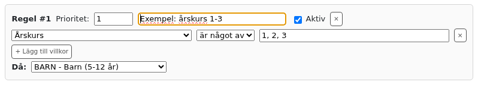

*Bild 11. En regel redigeras. Visar version 2.0.*

**Importera rollmappningen som regler.** Knappen **Importera "Mappning av låntagarkategorier" som regler** gör om rollmappningen till regler. Rollerna med samma åtgärd grupperas och första förekomsten av en roll gäller. Knappen sparar aldrig själv: granska reglerna och tryck **Spara**.

**Vanliga misstag.**
- Reglerna gör ingenting eftersom **Använd regler** inte är ikryssat.
- En allmän regel med låg siffra för prioritet står före en specifik regel och "äter" den. Ge den specifika regeln lägre nummer.
- Rollvillkor utan uppdrag i IST. Anslutningstestet i 3.1 säger om uppdrag ingår.
- Klassnamn som varierar. Använd **börjar med** eller **innehåller** i stället för **är något av**.

### 3.7 Schema och kör nu

**Syfte.** Bestämma när importen körs och starta den vid behov. (F-35 till F-38)

*Bild 12. Schema och kör nu när ingen körning pågår. Visar version 2.0.*

**Schema.** Tabellen har kolumnerna Dag och Tid. Tryck **Lägg till tid**, välj dag och skriv klockslag, till exempel måndag 08:00. Tiderna är **servertid**. Tryck **Spara** för att behålla schemat. Utan rader startar schemat ingenting.

- En schemalagd start som missats startas upp till en timme sent, men aldrig två gånger samma dag.
- Schemat kan ha upp till 50 rader.

**Kör nu.** Knapparna **Kör import nu** och **Hämta värden från IST nu** startar ett jobb inom en minut.
- **Kör import nu** frågar först, eftersom importen börjar om från första sidan och uppdaterar låntagare.
- **Hämta värden från IST nu** läser skolor, skoltyper, årskurser, utbildningskoder, klasser och roller från IST och sparar dem. Inget i Koha ändras och inga personuppgifter sparas. Det kan ta flera minuter.
- Finns redan ett jobb av samma sort som väntar eller körs får du beskedet "Ett jobb av den här typen väntar redan eller körs." Ett nytt import-jobb väntar tills en pågående import är klar.

**Status.** En färgad ruta säger om minutjobbet är aktivt:
- "Schemaläggningen är aktiv ..." och när minutkontrollen sågs senast: allt fungerar.
- "Schemaläggningen verkar inte vara aktiv just nu ...": minutkontrollen har inte setts på mer än tre minuter.
- "Schemaläggningen är inte aktiv. ...": minutkontrollen har aldrig setts. Kontakta systemadministratören.

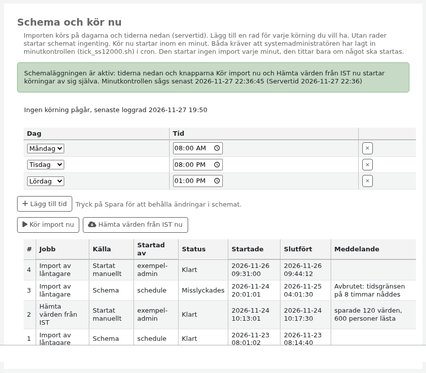

*Bild 13. Status när minutjobbet är aktivt. Visar version 2.0.*

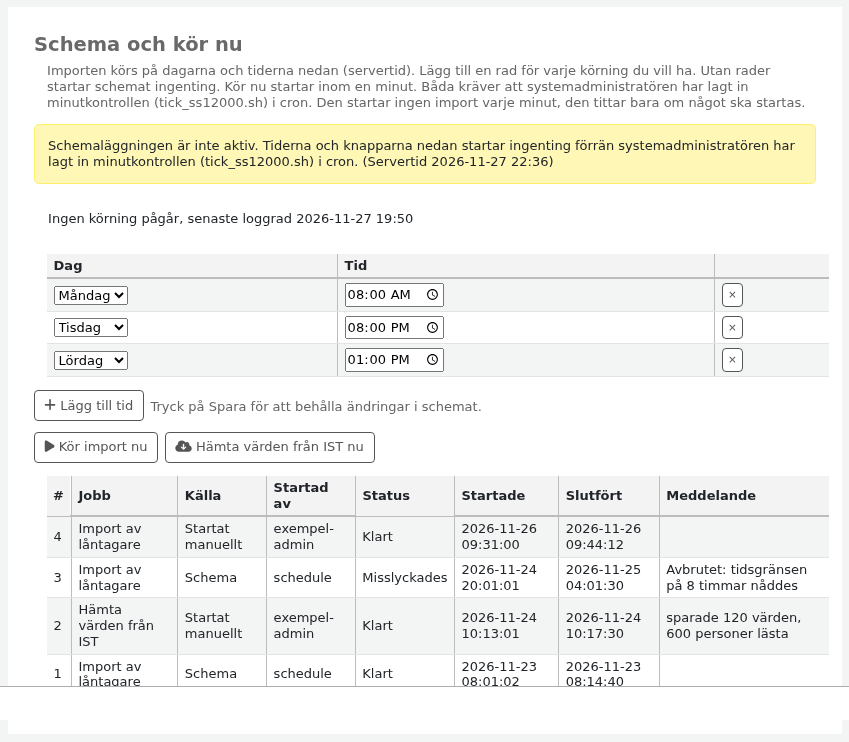

*Bild 14. Status när minutjobbet saknas. Visar version 2.0.*

Står "En körning pågår" visas också vad som visar det: låsfil, jobbkön, cron-skriptet eller loggaktivitet de senaste 10 minuterna, och tidpunkten för senaste loggraden.

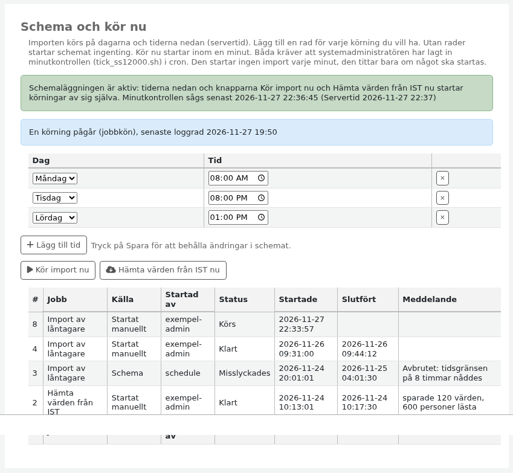

*Bild 15. Schema och kör nu med en pågående körning. Visar version 2.0.*

**Jobblistan** visar de senaste jobben med kolumnerna #, Jobb (Import av låntagare eller Hämta värden från IST), Källa (Startat manuellt eller Schema), Startad av, Status (Väntar, Körs, Klart, Misslyckades), Startade, Slutfört och Meddelande. Meddelandet förklarar varför ett jobb stoppats, till exempel att tidsgränsen på 8 timmar nåddes.

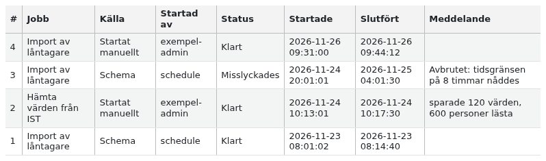

*Bild 16. Jobblistan med några exempeljobb. Visar version 2.0.*

**Vanliga misstag.**
- Schemat sparas inte för att du glömde **Spara**.
- Du förväntar dig lokal tid. Tiderna är servertid.
- Status "inte aktiv": schemat och knapparna startar ingenting förrän systemadministratören lagt in minutjobbet i cron.

### 3.8 Personal

**Syfte.** Läsa in personal från IST:s uppdrag. (F-27, F-28)

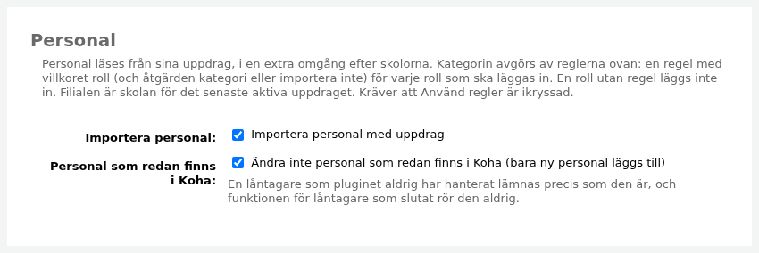

*Bild 17. Sektionen Personal. Visar version 2.0.*

Personal importeras i en extra omgång efter skolorna, för personer med ett aktivt uppdrag. Det kräver tre saker:

1. Uppdrag ingår i er beställning från IST (anslutningstestet säger det).
2. **Använd regler** är ikryssad (3.6).
3. **Importera personal** ("Importera personal med uppdrag") är ikryssad.

Kategorin avgörs av reglerna: gör en regel med villkoret **Roll (dutyRole)** för varje roll som ska importeras, med en kategori som åtgärd. **En roll utan regel importeras inte.** Biblioteket är skolan för personens senaste aktiva uppdrag vars skola finns i skolmappningen. Finns ingen sådan skola används **Standard bibliotek** om ett är valt, annars importeras personen inte. Den som också är elev lämnas till elevomgången.

**Personal som redan finns i Koha.** Kryssrutan "Ändra inte personal som redan finns i Koha (bara ny personal läggs till)" är ikryssad som standard. Då lämnas en låntagare som pluginet aldrig hanterat precis som den är (matchning på personnummer i kortnummer, användar-ID eller personnummerattributet), och funktionen för låntagare som slutat rör den aldrig. Pluginet kan alltså inte skriva över personal som biblioteket redan lagt in för hand.

**Vanliga misstag.**
- Personal importeras inte för att uppdrag inte ingår i IST-beställningen. Det går inte att lösa i pluginet.
- Personal importeras inte för att en roll saknar regel.
- Personal hamnar på standardbiblioteket för att uppdragets skola inte finns i skolmappningen.

### 3.9 Låntagare som slutat

**Syfte.** Hantera låntagare som inte längre finns i elevregistret, så att ingen som slutat förblir identifierbar för alltid. (F-29 till F-32)

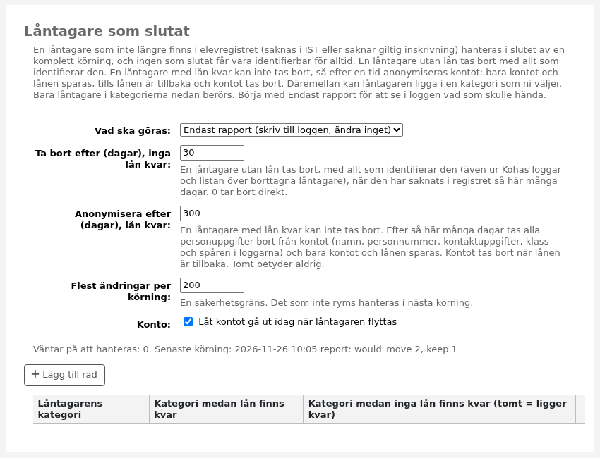

*Bild 18. Sektionen Låntagare som slutat med exempelkategorier. Visar version 2.0.*

**Vilka räknas som att de slutat.** Efter en komplett körning kontrollerar pluginet mot IST de låntagare som importen hanterat men inte sett idag. Den som inte finns i IST, eller saknar giltig inskrivning, får en markering i anteckningen ("No update"). Funktionen hanterar de låntagare som har den markeringen. Återkommer en låntagare i IST behandlas den som vanligt igen.

| Fält | Vad det gör |
|---|---|
| Vad ska göras | **Ingenting (av)** (standard), **Endast rapport (skriv till loggen, ändra inget)** eller **Flytta och ta bort**. |
| Ta bort efter (dagar), inga lån kvar | Standard 30. Låntagare utan lån tas bort efter så många dagar som de saknats. 0 tar bort direkt. |
| Anonymisera efter (dagar), lån kvar | Standard 300. Låntagare med lån kvar kan inte tas bort, så efter så många dagar tas alla personuppgifter bort från kontot. Tomt betyder aldrig. |
| Flest ändringar per körning | Säkerhetsgräns, standard 200. Det som inte ryms hanteras i nästa körning. |
| Konto | Kryssrutan "Låt kontot gå ut idag när låntagaren flyttas". På som standard. |

Under inställningarna visas "Väntar på att hanteras" (antal) och "Senaste körning".

**Tabellen.** Per låntagarkategori anger du två kategorier: **Kategori medan lån finns kvar** och **Kategori medan inga lån finns kvar (tomt = ligger kvar)**. Bara låntagare i en kategori som står i kolumnen **Låntagarens kategori** berörs. Personal och systemkonton är säkra om du inte lägger in deras kategori.

**Vad som händer med låntagaren.**

| Läge | Utan lån | Med lån kvar |
|---|---|---|
| Först | Flyttas till kategorin för "inga lån" (om du angett en) och väntar | Flyttas till kategorin för "lån kvar" |
| Kontot | Går ut idag (om du valt det) | Går ut idag (om du valt det) |
| Efter angivet antal dagar | **Tas bort**, med allt som identifierar personen, också ur Kohas loggar och listan över borttagna låntagare | **Anonymiseras**: namn, personnummer, kontaktuppgifter, födelsedatum, anteckningar, attribut och spar i loggarna tas bort. Kontot och lånen behålls, användar-ID blir `anon` och låntagarens nummer |
| När lånen är tillbaka | Behandlas som "utan lån" | Kontot har inga lån och behandlas som "utan lån": det tas bort så snart det varit borta ur registret lika många dagar som "Ta bort efter (dagar), inga lån kvar". Med standardvärdena (30 och 300) sker det vid nästa körning |

Koha kan neka borttagning, till exempel vid ej betalda avgifter. Låntagaren ligger då kvar och försöks igen vid nästa körning.

**Börja så här.**
1. Välj **Endast rapport**. Låt en körning gå klart.
2. Titta efter raden "Senaste körning" och i loggfilen. Den visar hur många som skulle flyttas, tas bort eller anonymiseras ("would_delete", "would_move", "would_anonymize").
3. När det ser rätt ut: välj **Flytta och ta bort**.

Borttagning och anonymisering går inte att ångra. Ta en säkerhetskopia av databasen först.

**Vanliga misstag.**
- Du väljer **Flytta och ta bort** utan att ha provat **Endast rapport**.
- Tabellen är tom. Inget händer då, även i läget **Flytta och ta bort**, och loggen säger att tabellen är tom.
- Du lägger in kategorin för en grupp du inte vill röra. Bara kategorierna i tabellen berörs.
- Du förväntar dig att något händer mitt i dagen. Kontrollen görs bara efter en komplett körning.

### 3.10 Avancerat

**Syfte.** Inställningar som själva körningen och loggarna. (F-26, F-44, F-45)

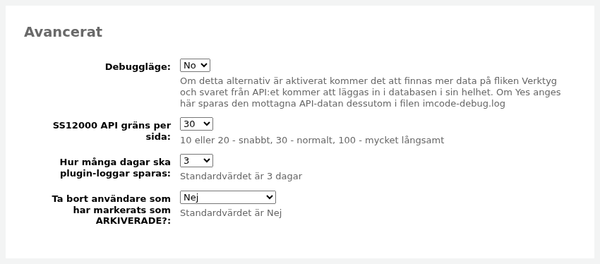

*Bild 19. Sektionen Avancerat. Visar version 2.0.*

| Fält | Vad det gör |
|---|---|
| Debuggläge | **Ja**: hela svaret från IST sparas i databasen och mycket detaljerad loggning skrivs till loggfilen `imcode-export-users.log` på servern. Används vid felsökning. Standard i en ny installation: Nej. Innehåller personuppgifter när det är på och gör loggen mycket stor. |
| SS12000 API gräns per sida | Antal personer per sida från IST: 10, 20, 30 (standard), 40, 50, 75, 100, 300 eller 500. Lite = snabbare svar per sida men fler sidor. |
| Hur många dagar ska plugin-loggar sparas | Hur länge importloggen (importkörningarna) sparas: 1, 2, 3 (standard), 7, 14, 30, 60, 90 eller 120 dagar. Importen rensar vid varje körning. |
| Ta bort användare som har markerats som ARKIVERADE? | **Nej** (standard) eller ja efter 3, 7, 14 eller 30 dagar. Gäller dubbletter som pluginet arkiverat när det slått ihop två låntagare. |

**Vanliga misstag.**
- Debuggläge lämnas på. Loggen växer snabbt och innehåller personuppgifter. Stäng av det när felet är hittat.
- Höga värden gör varje anrop långsammare (sidans hjälptext: 30 normalt, 100 mycket långsamt). Börja med 30.

### 3.11 Loggen

**Syfte.** Se vad importen gjort och varför. (F-41 till F-43)

Loggsidan heter **SS12000-logg**. Du når den från Administration > Plugins > "Importerade SS12000-användare (logg)" eller från länken **SS12000-logg** på konfigurationssidan. Från loggsidan kommer du tillbaka via **Konfigurationsinställningar**.

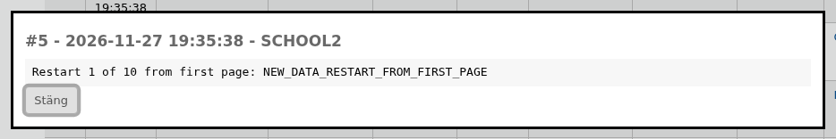

*Bild 20. Loggsidan med ett svar från IST uppfällt. Visar version 2.0.*

Sidan har två flikar:

- **Importkörningar (antal).** En rad per behandlad sida: ID, Tid, Organisation, Endpoint, Iteration, Tillagd, Uppdaterad, Behandlade, Status och Meddelande / svar. Klicka på meddelandet för att öppna hela svaret i en ruta. Stäng med **Stäng**.
- **Låntagarändringar (antal).** Varje ändring i en låntagare: ID, Tid, Låntagare (länk till låntagarens post), Åtgärder och Beskrivning (vilka fält som ändrats, från och till).

Filter: **Period** (Alla, Senaste 24 timmarna, 3 dagarna, 7 dagarna eller 30 dagarna), **Organisation** och **Status** (på fliken Importkörningar), **Åtgärder** (på fliken Låntagarändringar), ett sökfält, **Ladda om** och kryssrutan **Uppdatera var 10:e sekund** för att följa en pågående körning.

**Status i importkörningar** (visas på engelska):

| Status | Betyder |
|---|---|
| done | Sista sidan för skolan är behandlad. Skolan är klar för dagen. |
| more pages | Sidan är behandlad och det finns fler sidor. |
| pending | Sidan är hämtad men inte färdigbehandlad. |
| reset | Sidan har nollställts, till exempel av **Ställ in API-scanner från första sidan**. |
| restart | En omstart från första sidan på grund av att IST ändrat data (HTTP 410). |

**Åtgärder i låntagarändringar.** `update` (fält ändrade), `merge` (två låntagare slågna ihop), `no_longer_in_api` (finns inte längre i IST), `leaver_moved`, `leaver_anonymized` och `leaver_deleted` (hantering av låntagare som slutat, utan personuppgifter).

**Gallring.** Importkörningarna rensas av importen efter det antal dagar som står under **Avancerat** (sidan visar siffran). **Låntagarändringarna rensas inte av pluginet.** De försvinner bara för en låntagare som tas bort eller anonymiseras av funktionen för låntagare som slutat (3.9). Texten på loggsidan om att rader rensas gäller alltså bara importkörningarna.

Svaret från IST är tomt ("Debug Mode OFF" eller en sammanfattning som "Added: 3, Updated: 5, Total: 8") om **Debuggläge** är Nej. Med Ja innehåller det hela svaret med personuppgifter (kapitel 7).

**Vid en felanmälan** behöver supporten en skärmbild av loggsidan. Ta inte med personnummer.

## 4. Så fungerar en körning

En körning går i omgångar. Varje anrop till pluginet hämtar **en sida** (standard 30 personer) för **en skola** och sparar var det slutade. Ett skal-skript (`run_ss12000.sh`) anropar pluginet om och om igen tills allt är klart.

1. Pluginet tar de skolor i skolmappningen som inte är klara idag. För varje skola frågar det IST efter skolans id och hämtar sedan nästa sida med elever som har en giltig inskrivning vid skolan idag.
2. För varje person hämtas klass (och vid behov uppdrag) från IST. Sedan avgörs kategori och bibliotek, och låntagaren skapas eller uppdateras.
3. Sidan loggas som en rad i loggen: skola, antal tillagda, uppdaterade och behandlade, och var nästa sida börjar.
4. När IST inte har fler sidor för skolan får raden status "done", och skolan är **klar för dagen**.
5. När alla skolor (och personalomgången, om den är på) är klara gör pluginet slutsteget: statistik för dagen, en extra omgång för skolor som saknas i mappningen (om "Använd standard för ej mappade skolor" är på), kontroll av låntagare som inte setts idag (3.9) och hantering av låntagare som slutat. Därefter är dagen klar och fler anrop gör ingenting.

**"Klar för dagen"** betyder att loggen har en rad för dagens datum, för skolan, utan nästa sida och markerad som behandlad. Dagen byter vid midnatt servertid.

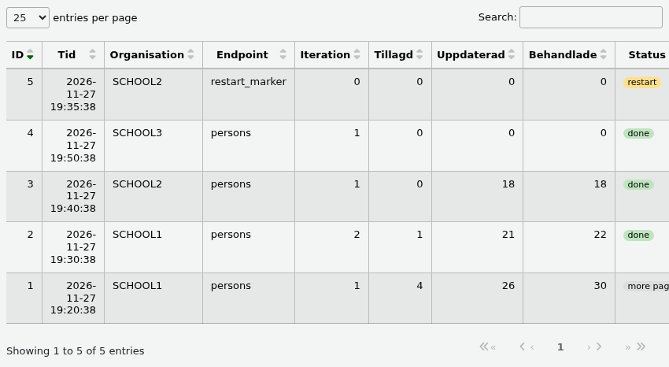

*Bild 21. Loggsidan med importkörningar. Visar version 2.0.*

**Om IST ändrar data mitt i körningen.** Svarar IST att sidans bokmärke inte längre gäller (HTTP 410, "NEW_DATA_RESTART_FROM_FIRST_PAGE") startar pluginet om skolan från första sidan. De som redan behandlats uppdateras bara igen. Det går högst 10 gånger per skola och dag. Efter det ger pluginet upp för den skolan, markerar den som klar för dagen med ett meddelande i loggen och försöker igen nästa dag. Varje omstart syns i loggen med status "restart".

**Om en skola saknas i IST.** Skolan markeras som klar för dagen med meddelandet att organisationskoden inte finns i IST, och körningen går vidare. Kontrollera skolmappningen.

**Om konfigurationen är fel.** Saknas skolmappning eller standardkategori stoppas körningen direkt. För körningar som startats från sidan eller schemat står då "Avbrutet: konfigurationsfel, se loggen" i jobblistan.

**Om en körning avbryts.** Skolor som redan är klara behåller sin status. Nästa körning fortsätter där det slutade. Körningen stoppar efter högst 8 timmar. Jobblistan visar då "Avbrutet: tidsgränsen på 8 timmar nåddes" eller "Avbrutet före sista sidan, se loggen".

**Att börja om.** Knappen **Ställ in API-scanner från första sidan** (längst ned) gör att dagens sidor behandlas om från början. Den är grå tills någon sida har behandlats idag. **Kör import nu** och schemat gör samma sak innan de startar. Sidan förklarar innan: "Starta om dagens import från första sidan? Sidor som redan behandlats idag behandlas igen."

**Samtidiga körningar.** Två importer körs aldrig samtidigt. Startar du en import medan en annan plågår väntar den nya och startar när den förra är klar. Det gäller även körningar som startats av en äldre cron-rad.

### Vad pluginet gör med varje person

- **Namn, kontaktuppgifter, födelsedatum, kategori, bibliotek, användar-ID, kortnummer, utgångsdatum och klass** sätts enligt inställningarna. Ändras ett värde skrivs det till ändringsloggen (3.11).
- **Anteckningen** (OPAC-anteckning) på låntagaren får en rad som börjar med "Added by SS12000" (ny) eller "Updated by SS12000" (uppdaterad), plugin-version och tid, och "Fields changed" eller "No changes". Finns en annan anteckning från biblioteket sedan tidigare behålls den.
- **Skippade personer** får en anteckning med orsaken efter "No update:", till exempel "no valid enrolment", "enrolment cancelled", "empty duty role" eller en regel ("rule #3"). Personer som inte redan finns i Koha får ingen anteckning eftersom det inte finns någon låntagare.
- **Dubbletter.** Hittas två låntagare för samma person väljer pluginet den som har mest anknytning (lån, reservationer, attribut, avgifter, meddelanden). Den andra arkiveras (användar-ID och kortnummer får prefixet `ARCHIVED_`) och dess lån, reservationer och avgifter flyttas till den som behålls. Sammanslagningen syns i ändringsloggen som "merge".
- **Ny låntagare med upptaget användar-ID eller kortnummer.** Pluginet tar då personnumret i stället och loggar det. Det blir inget dubblettfel.

## 5. Exempel från början till slut

Här är ett exempel med påhittade uppgifter: **tre skolor, årskurs 1–3 och två personalroller.**

**Utgångsläget.** Kommunen har tre skolor i IST: Exempelskolan (`SCHOOL1`), Provskolan (`SCHOOL2`) och Demoskolan (`SCHOOL3`). I Koha finns biblioteken `BECK` och `BRED`. SCHOOL1 och SCHOOL2 delar biblioteket `BECK`, SCHOOL3 använder `BRED`. Elever i årskurs 1–3 ska vara i kategorin `BARN`, alla andra elever i kategorin `UNG`. Personalen har rollerna Bibliotekarie och Lärare. Bibliotekarier ska in som `PERSONAL`, lärare ska inte importeras. Kategorierna och biblioteken finns redan i Koha med lånebestämmelser.

**Steg 1. Anslutningen.** Fyll i Client ID, Client Secret och Customer ID, tryck **Spara** och sedan **Testa anslutningen**. Svaret: "Ansluten till IST. 3 organisationer hittades." Uppdrag ingår, så personal kan importeras.

**Steg 2. Skolmappningen.** Tryck **Hämta organisationer från IST**. Tre rader visas. Välj bibliotek:

| Organisationskod | Koha-filial |
|---|---|
| SCHOOL1 | BECK |
| SCHOOL2 | BECK |
| SCHOOL3 | BRED |

**Steg 3. Standardkategori.** Välj `UNG` som **Standard låntagarkategori**. Alla som inte får annan kategori hamnar där.

**Steg 4. Identiteten.** Låntagarna i Koha är nya, så låt **Användar-ID för Koha** och **Kortnummer för Koha** stå på personnummer. Välj **Personnummerattribut** `PNR` (finns i Koha) och kryssa i **Låntagarattribut** för matchning, så att personen känns igen även om kortnumret byts senare. Kryssa i **Lägg till på e-postadresser** med texten `.NOEMAIL` tills biblioteket är redo att skicka meddelanden.

**Steg 5. Reglerna.** Kryssa i **Använd regler**. Lägg till tre regler:

| Prioritet | Namn | Villkor | Då |
|---|---|---|---|
| 1 | Exempel: årskurs 1-3 | Årskurs är något av 1, 2, 3 | BARN |
| 2 | Exempel: bibliotekarie | Roll (dutyRole) är något av Bibliotekarie | PERSONAL |
| 3 | Exempel: lärare | Roll (dutyRole) är något av Lärare | Importera inte |

En elev i årskurs 2 får `BARN` (regel 1). En elev i årskurs 5 får ingen träff och hamnar i standardkategorin `UNG`. En bibliotekarie får `PERSONAL` (regel 2), en lärare importeras inte (regel 3).

**Steg 6. Personal.** Kryssa i **Importera personal** under **Personal**. Låt rutan "Ändra inte personal som redan finns i Koha" stå ikryssad.

**Steg 7. Spara och kontrollera.** Tryck **Spara**. Du ska se "Konfigurationen har uppdaterats framgångsrikt" och ingen varning.

**Steg 8. Kör.** Tryck **Kör import nu**, eller lägg in en tid i schemat, till exempel måndag 20:00. På loggsidan dyker en rad upp per skola och sida. När SCHOOL1, SCHOOL2, SCHOOL3 och personalomgången har rader med status "done" är dagen klar.

**Steg 9. Kontrollera.** Öppna en låntagare i Koha. Du ska se rätt kategori, rätt bibliotek, klassen i attributet Klass och personnumret i attributet PNR. Låntagarens anteckning börjar med "Added by SS12000".

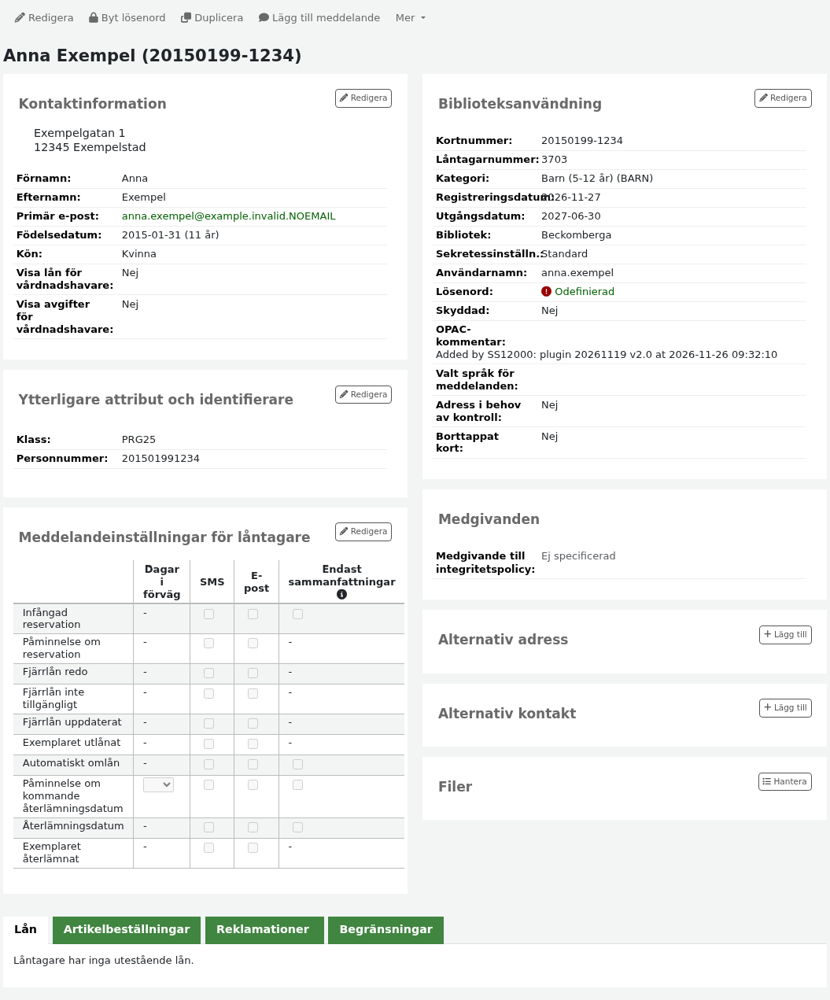

*Bild 22. En importerad låntagare (Anna Exempel) med kategori, klassattribut och anteckning. Visar version 2.0.*

## 6. Vanliga frågor och felsökning

**Jag ser inte pluginet under Administration > Plugins.**
Plugin kan vara avstängda i Koha. Det är en fråga för systemadministratören (se Installation_sv.md).

**Sidan visar en felruta om en saknad modul.**
Perl-modulen `URI::Encode` saknas på servern. Systemadministratören installerar den (Installation_sv.md).

**Sidan visar VARNING om mappning.**
Skolmappning saknas, eller standardkategorin saknas eller finns inte i Koha. Ordna det i 3.3 och 3.4 och tryck **Spara**.

**"Testa anslutningen" svarar "Kunde inte hämta en åtkomsttoken. Kontrollera Client ID, Client Secret och OAUTH API URL."**
Kontrollera Client ID, Client Secret och URL för åtkomsttoken. Har du ändrat dem: spara först, testa sedan. Svarar sidan "Spara Client ID, Client Secret och Customer ID först och försök sedan igen." saknas de sparade uppgifterna.

**"Testa anslutningen" svarar "Token hämtades, men organisationer svarade med HTTP ...".**
Kontrollera API URL och Customer ID. Hjälper inte det: kontakta IST.

**Anslutningstestet säger "Duties (personalroller) ingår inte i kundens prenumeration.", eller "Hämta roller från IST" ger HTTP 403.**
Uppdrag ingår inte i er beställning hos IST. Personalimport och rollvillkor kan då inte fungera. Det är inget fel i pluginet. Be IST lägga till uppdrag.

**En skola importeras inte.**
1. Finns skolan i skolmappningen? Annars: lägg till, eller slå på "Använd standard för ej mappade skolor" med ett **Standard bibliotek**.
2. Står det "Finns inte i IST" på raden? Organisationskoden i mappningen finns inte i IST. Rätta den.
3. Titta på loggen: finns en rad för skolan med status "done" och noll behandlade? Då har IST inga elever med giltig inskrivning vid skolan idag.

**Kategorin blir tom eller fel.**
- Tom kategori: standardkategorin saknas eller har tagits bort i Koha. Välj en som finns.
- Fel kategori med **Använd regler**: en regel med lägre prioritetsnummer träffar först. Reglerna prövas i ordning och den första träffen avgör. Titta på prioriteterna (3.6).
- Befintliga låntagare byter inte kategori: kryssrutan **Kategori för befintliga låntagare** är ikryssad.
- Alla får standardkategorin: **Använd regler** är inte ikryssat, eller ingen regel träffar, eller rollmappningen är tom.

**Eleverna dubbleras.**
Matchningen i 3.2 pekar på något som inte är lika i Koha och IST. Ställ in matchning efter hur era låntagare ser ut. Dubbletter som uppstått kan slås ihop av pluginet när matchningen sedan hittar båda.

**Låntagare får e-post som slutar på `.NOEMAIL`.**
Kryssrutan **Lägg till på e-postadresser** är ikryssad. Kryssa ur den när biblioteket är redo. Adresserna rättas vid nästa import.

**Klassen visas inte.**
Kontrollera att **Klassattribut** pekar på en attributtyp som finns (eller `CL`). Klassen hämtas bara om både gruppen och elevens medlemskap gäller idag. Finns flera giltiga klasser väljs den i skolan där eleven har sin inskrivning, därefter den med nyast medlemskap.

**En körning startar inte.**
1. Se rutan under **Schema och kör nu**. "Schemaläggningen är inte aktiv" betyder att minutjobbet saknas i cron. Kontakta systemadministratören.
2. Syns jobbet i jobblistan med status "Väntar"? Det väntar då på att en annan import ska bli klar.
3. Står det "Avbrutet: konfigurationsfel, se loggen"? Då saknas skolmappning eller standardkategori.
4. Sidan visar att en körning pågår men inget händer? Titta på loggens senaste rad. Stannar loggen är körningen sannolikt avbruten. Skriv till supporten.

**"Schemaläggningen verkar inte vara aktiv just nu".**
Minutjobbet har inte setts på mer än tre minuter. Kontakta systemadministratören. Planerade körningar startas upp till en timme sent när jobbet kommer igång igen, men aldrig två gånger samma dag.

**Jobbet står som Misslyckades.**
Läs kolumnen Meddelande. "Avbrutet: tidsgränsen på 8 timmar nåddes" kan bero på en mycket stor skola, långsamt IST eller lite `API gräns per sida`. "Avbrutet före sista sidan, se loggen" betyder att körningen stoppade. Starta om med **Kör import nu**.

**Samma skola startar om om och om igen.**
IST har ändrat data under körningen (status "restart" i loggen). Efter 10 omstarter går pluginet vidare till nästa dag. Prova igen vid en lugnare tid.

**Jag har bytt källa för användar-ID eller kortnummer och importen börjar om.**
Det är avsikten. Dagens import startar om från första sidan så att alla får de nya värdena.

**En låntagare försvann eller har blivit "Anonymiserad".**
Funktionen för låntagare som slutat (3.9) har hanterat låntagaren. Titta i ändringsloggen efter `leaver_deleted` eller `leaver_anonymized`.

**Jag vill veta vilken regel som avgjorde för en person.**
Pluginet sparar det i databasen (tabellen `imcode_rule_log`), men det visas ännu inte på någon sida. Be systemadministratören titta, eller slå på Debuggäge en stund (kapitel 7).

**Vad ska jag skicka till supporten?**
Version, vad du gjorde, vad du väntade dig, vad som hände, klockslag och en skärmbild av loggsidan. Skicka aldrig personnummer.

## 7. Dataskydd

Detta beskriver vad pluginet gör. Det är inga juridiska råd.

**Vad som sparas och var.**

| Vad | Var | Hur länge |
|---|---|---|
| Elever och personal som låntagare: namn, personnummer, födelsedatum, kontaktuppgifter, adress, klass | Kohas låntagarregister | Tills låntagaren tas bort eller anonymiseras (3.9) eller du tar bort den |
| IST-hemligheten (Client Secret) | Pluginets inställningar i databasen, förvrängd | Tills du byter den eller tar bort pluginet |
| Importloggen (sidor, antal, meddelanden) | Databasen | Antal dagar enligt **Avancerat** (standard 3) |
| Hela svar från IST | Importloggen, **bara** om Debuggläge är Ja | Som importloggen |
| Ändringsloggen (vilka fält som ändrats, från och till) | Databasen | **Rensas inte av pluginet.** Rader för en låntagare tas bort när låntagaren tas bort eller anonymiseras av funktionen för låntagare som slutat |
| Regelbeslut per person | Databasen (`imcode_rule_log`) | 90 dagar efter senaste uppdatering |
| Pluginets loggfil (`imcode-export-users.log`) | Servern, i Kohas loggkatalog | Rensas av serverns loggrotation (inte av pluginet) |
| Anteckning på låntagaren (OPAC-anteckning) | Kohas låntagarregister | Som låntagaren |
| Värden från IST (skolor, klasser, roller, årskurser) | Databasen (`imcode_seen_values`) | Skrivs om vid varje hämtning. Inga personuppgifter |

**Loggfilen.** Pluginets loggfil på servern får en rad för nästan varje åtgärd när **Debuggläge** är Ja, med bland annat namn, personnummer och e-postadresser. Även när det är Nej skrivs vissa rader som kan innehålla personnummer eller fältvärden: kontrollen av låntagare som inte setts idag (kortnummer), ett upptaget användar-ID eller kortnummer, och ändringar av fält (från och till). Loggfilen roteras av serverns standardregel för Koha-loggar om systemadministratören inte ordnat något annat (se Installation_sv.md). Be systemadministratören begränsa åtkomsten till loggkatalogen.

**Vad du själv styr.**
- **Debuggläge.** Stäng av det i normal drift. Använd det bara vid felsökning.
- **Hur många dagar plugin-loggar ska sparas** (Avancerat).
- **Låntagare som slutat** (3.9): när och hur de tas bort eller anonymiseras.
- **Vilka personer som importeras** (rollmappning, regler, personal av/på).
- **Personnummer.** Du väljer om det sparas i ett attribut och om det blir användar-ID och kortnummer. Personnummer som användar-ID och kortnummer ligger i Kohas låntagarregister och så syns för den som har tillgång till låntagarposterna. Vill ni undvika det: välj **Skol-e-post** som användar-ID och **Behåll det befintliga värdet** eller **Externt id** som kortnummer.

**Vad som händer när en låntagare tas bort av funktionen för låntagare som slutat.** Utan lån: låntagaren tas bort med Kohas egen kontroll, utlånehistoriken anonymiseras, posten kopieras inte till listan över borttagna låntagare, och spar tas bort i Kohas åtgärdslogg, pluginets ändringslogg, regelloggen och meddelandekön. Med lån kvar: se anonymisering i 3.9.

**Vad som inte omfattas av funktionen.** Pluginets loggfil på servern och svaren i importloggen (när Debuggläge är Ja), och listan över borttagna låntagare från borttagningar som gjorts på annat sätt än genom pluginet.

## 8. Ordlista

| Ord | Betyder |
|---|---|
| IST | Leverantören av skolans elevregister som pluginet hämtar uppgifter från |
| SS12000 | Den svenska standarden för hur skoldata utbyts |
| Organisation | En skola eller annan enhet i IST |
| Organisationskod | Enhetens kod i IST, till exempel `SCHOOL1` |
| Inskrivning | Att en elev går vid en skola under en tid (start- och slutdatum) |
| Uppdrag (duty) | En anställds roll vid en skola i IST. Krävs för personal och rollvillkor |
| Roll (dutyRole) | Uppdragets roll, till exempel Lärare |
| Filial / bibliotek | Ett bibliotek i Koha. I sidan heter det ofta Koha-filial |
| Skolmappning | Kopplingen mellan en skola i IST och ett bibliotek i Koha |
| Kategori | Låntagarkategori i Koha. Styr lånebestämmelser |
| Regel | Villkor och en åtgärd som avgör kategori, se 3.6 |
| Attribut | Ett extra fält på låntagaren i Koha, till exempel Klass |
| OPAC-anteckning | Anteckningen på låntagaren som pluginet skriver |
| Trigger | En funktion i databasen som lagrar ändringar i låntagare |
| Cron | Serverns tidsstyrda uppgifter. Minutjobbet ligger i cron |
| Minutjobbet | Cron-raden som körs varje minut och startar schemalagda körningar och kör-nu |
| Sida | Ett antal personer (standard 30) som hämtas från IST på en gång |
| Klar för dagen | Skolans sista sida för dagens datum är behandlad |
| Anonymisera | Ta bort allt som identifierar en person men behåll kontot för lånens skull |
| Debuggläge | Detaljerad loggning för felsökning. Innehåller personuppgifter |
