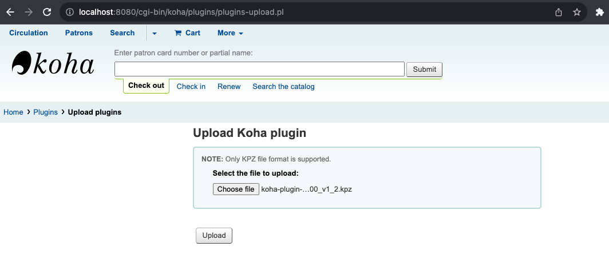
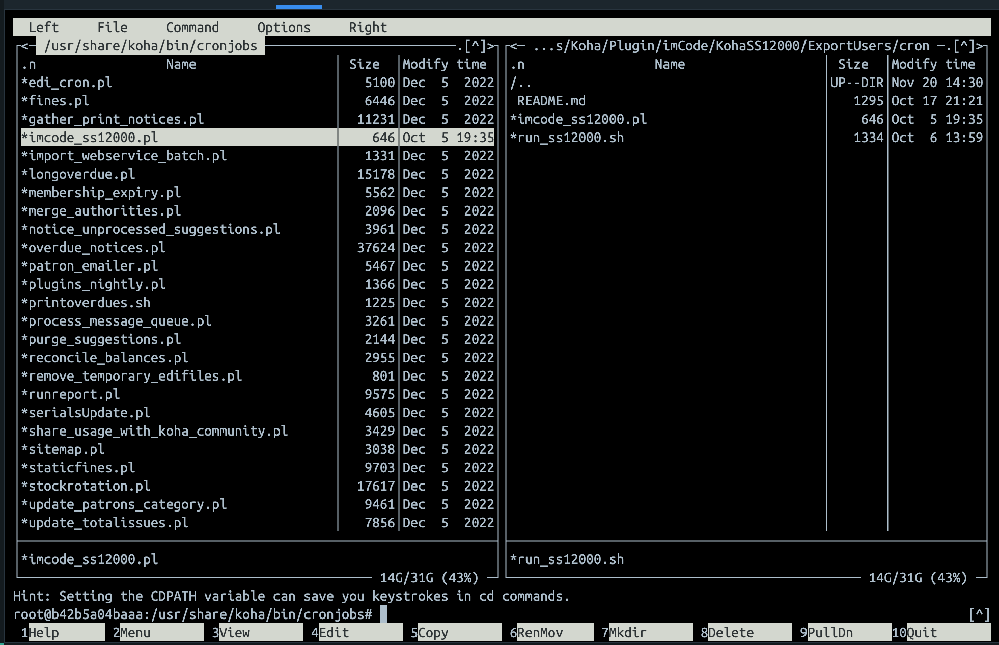
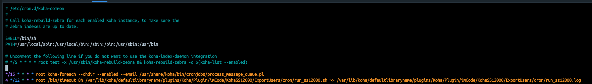
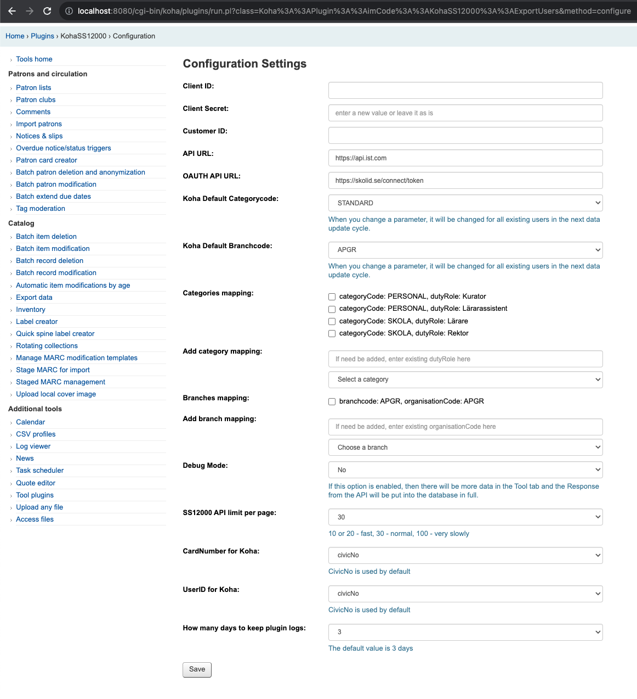
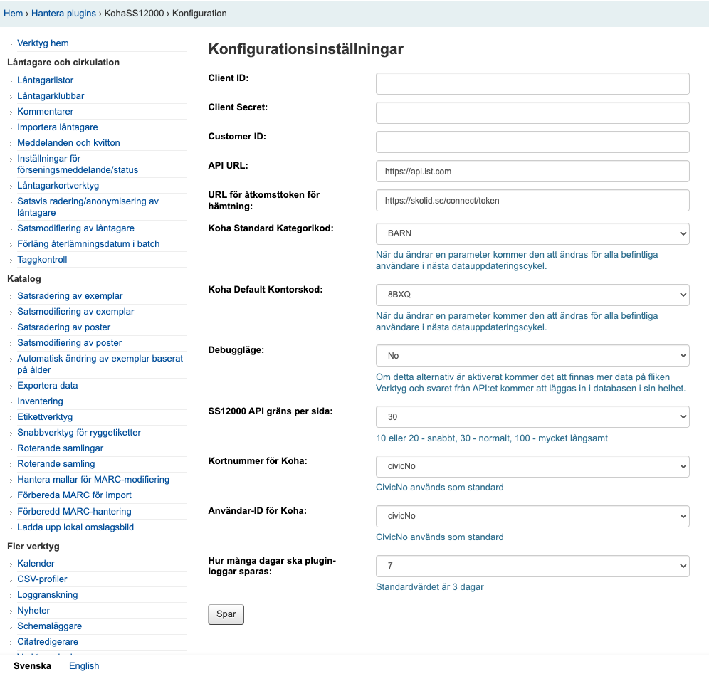

# KOHASS12000


This is a plugin for [Koha](https://github.com/Koha-Community/Koha) by [imCode](https://imcode.com)

It exports user data from the API in SS12000 format to your Koha database

Plugin and cron jobs for importing SS12000 v 1.90

[SS12000 Fields Specification](Doc/SS12000_Fields_Specification.md)

2025-03-19

[1.90 version of koha-plugin-export-users_ss12000](https://github.com/imCodePartnerAB/KOHASS12000/releases/tag/v1.90)


# KohaSS12000 › Installation and CRON

1. Add the [latest version of the plugin](https://github.com/imCodePartnerAB/KOHASS12000/releases) to Koha



2. Run this command on a server running Koha:
```
sudo service memcached restart ; sudo service koha-common restart
```
3. Put perl script [Koha/Plugin/imCode/KohaSS12000/ExportUsers/cron/imcode_ss12000.pl](Koha/Plugin/imCode/KohaSS12000/ExportUsers/cron/imcode_ss12000.pl) to 
```
/usr/share/koha/bin/cronjobs
```


4. Shell script [run_ss12000.sh](Koha/Plugin/imCode/KohaSS12000/ExportUsers/cron/run_ss12000.sh)

Examples of use in cron:
```
4 */12 * * * root /bin/timeout 8h /var/lib/koha/defaultlibraryname/plugins/Koha/Plugin/imCode/KohaSS12000/ExportUsers/cron/run_ss12000.sh 
```


**run_ss12000.sh** - the script has protection against re-running. It also has a runtime limit, which is **8 hours by default**.

5. After you've added a script call to cron, you need to restart cron on the server running Koha:
```
sudo /etc/init.d/cron restart
```

# KohaSS12000 › What is new in 1.91

**Configuration page**
- Reorganised into sections (connection, patron identity, import rules, branches mapping, categories mapping, advanced).
- Also reachable from *Administration > Plugins* (the plugin appears there with its own link).
- The client secret is never sent back to the browser. Leave the field empty to keep the stored secret.
- **Test connection** checks the saved IST settings and reports whether duties (staff roles) are part of the subscription.
- **Branches mapping**: load the organisations from IST, pick the Koha branch from a dropdown for each one, or press *Suggest mapping from names*. Several organisations can use the same branch. Organisations that are mapped but no longer exist in IST are highlighted.
- **Categories mapping**: load the roles (dutyRole) from IST and pick the Koha category from a dropdown.

**About box**
- The configuration page starts with an *About* box (imCode logo, short description of what the plugin does, contact and links). The logo is `ExportUsers/images/logo_imcode_footer.png` and is embedded in the page, because many Koha installations do not serve static plugin files. All texts in the box are in the language files.

**Translations (language files)**
- All texts shown by the plugin (pages, messages from the server, plugin name and description, the log link under *Administration > Plugins*) are read from plain gettext `.po` files in `Koha/Plugin/imCode/KohaSS12000/ExportUsers/`: `sv.po`, `fi.po`, ... The language follows the Koha interface language (`sv-SE` uses `sv-SE.po` if it exists, otherwise `sv.po`). A text without a translation is shown in English.
- No compiled `.mo` files and no system locale are needed (the previous gettext/locale setup did not work on Koha 26.05 and has been removed).
- To add a language: copy `com.imcode.exportusers.pot` to `<code>.po`, translate every `msgstr` and keep the `%s` placeholders. The file is picked up automatically (changes are read again when the file changes; restart Plack if a language has just been added).

**Log viewer**
- A new *SS12000 log* page (link in the navigation bar of the configuration page, or `...run.pl?class=...&method=admin&op=log`) shows the plugin's database log in two sortable, searchable, paged tables: *Import runs* (`imcode_logs`: one row per processed page, with organisation, counts, state and message) and *Patron changes* (`imcode_data_change_log`, linked to the patron).
- Koha shows only one link per plugin on *Administration > Plugins*, so the `.kpz` also contains a tiny companion plugin, `Koha::Plugin::imCode::KohaSS12000::ExportUsersLog` ("Imported SS12000 users (log)"), that adds a second entry there which opens the log page.
- Filter by period, organisation, state and action; the full API response of a run can be opened per row; optional auto refresh every 10 seconds to follow a running import.

**Patron identity (new settings)**
- *Find existing patrons by*: user id, card number and/or a patron attribute (for example `CIVICNO`, the civic number attribute). Default is user id + card number, as before.
- *UserID for Koha*: civic number, external identifier, school e-mail (part before @ or the whole address) or keep the existing value.
- *CardNumber for Koha*: civic number, external identifier or keep the existing value.
- *Append to e-mail addresses*: a checkbox plus a text (default `.NOEMAIL`). When ticked, the text is added to the end of every imported e-mail address (both `email` and `B_email`), so Koha cannot send notices before go-live. Off by default (addresses are imported as they are); the text is kept when the box is unticked. The user id is derived from the address without the text. Untick the box to start sending; the addresses are corrected in the next import.
- *Category of existing patrons* (checkbox, off by default): when ticked, the category is only set for new patrons; existing patrons keep their category, so categories handled in Koha are not overwritten by the default category.
- *Contact details* (checkbox, off by default): when ticked, an empty e-mail, phone, mobile or address from IST never replaces a value the patron already has in Koha. Patrons that lack these details in IST are imported either way.
- *Civic number attribute*: patron attribute type that holds the civic number. Used for matching and kept up to date.
- *Class attribute*: patron attribute type where the class is stored (default `CL`).

**Fixes**
- HTTP 410 (`NEW_DATA_RESTART_FROM_FIRST_PAGE`) from IST restarts the organisation from the first page (max 10 restarts per organisation and day, error code and response are logged).
- Organisations that do not exist in IST no longer block the final steps of a run (and the cron wrapper no longer loops on them).
- The class is chosen from classes where both the group and the student's own membership are valid today. If several remain, the class of the school where the student has the active enrolment wins, then the newest membership; the order is deterministic and all candidates are logged.
- The category (role) mapping is optional: a customer without staff roles needs only the branch mapping and a default category. A new installation no longer creates any example role mappings.
- Matching on the civic number attribute compares digits only, so a stored `20120811-4011` matches `201208114011`.
- A new patron never takes a user id or card number that already belongs to someone else: it falls back to the civic number (logged), instead of failing with a duplicate key error.
- An existing date of birth is no longer erased when IST does not deliver `birthDate`. It is derived from the civic number when possible.
- When the duties endpoint answers 403 it is asked once per run, not once per student.
- Organisation lookups are cached during a run.
- The plugin log is written as UTF-8.
- `mark_missing_users_from_api` looks up the civic number in the civic number attribute when one is configured.

# KohaSS12000 › Configuration




If you need to start parsing data right now and don't want to wait for the script to be called through the cron, run this command on the server:
```
/var/lib/koha/defaultlibraryname/plugins/Koha/Plugin/imCode/KohaSS12000/ExportUsers/cron/run_ss12000.sh 
```

**defaultlibraryname** - this should be the name you gave when installing Koha


Make your GitHub documentation look good, use [writing-on-github](https://docs.github.com/en/get-started/writing-on-github/getting-started-with-writing-and-formatting-on-github/basic-writing-and-formatting-syntax)
